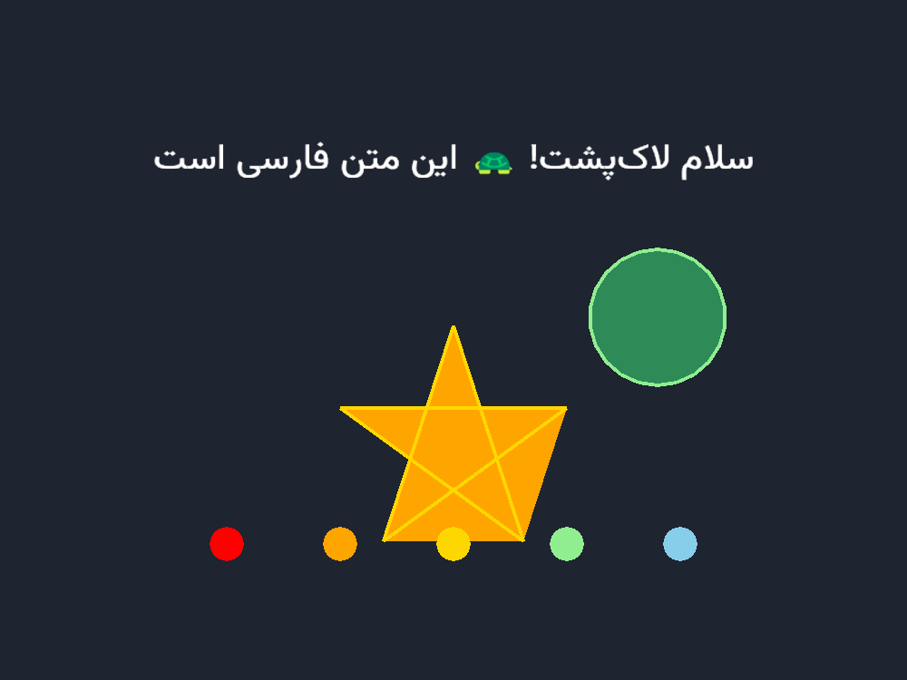

# ArcadeTurtle 🐢

کتابخانه‌ای آموزشی: همان دستورهای ماژول استاندارد `turtle` پایتون، اما با
موتور گرافیکی مدرن **[Arcade](https://api.arcade.academy/)** — حرکت نرم،
پنجره باکیفیت، و پشتیبانی کامل از متن فارسی در `write()`.



## نصب

```bash
python -m venv .venv
.venv\Scripts\activate        # ویندوز
pip install -e .
```

## شروع سریع

```python
import arcadeturtle as turtle

for _ in range(4):
    turtle.forward(100)
    turtle.left(90)

turtle.done()
```

همین! هر برنامه‌ای که با ماژول `turtle` استاندارد نوشته باشی، معمولاً فقط با
تغییر همین یک خط `import` روی ArcadeTurtle هم اجرا می‌شود.

## مثال‌ها

مثال‌ها در پوشه‌ی [`examples/`](examples/) از ساده به پیشرفته مرتب‌اند:

| فایل | چه چیزی یاد می‌دهد |
|---|---|
| [`00_healthcheck.py`](examples/00_healthcheck.py) | آیا Arcade و متن فارسی روی سیستم تو کار می‌کنند؟ |
| [`01_square.py`](examples/01_square.py) | اولین حرکت، چرخش و حلقه |
| [`02_star.py`](examples/02_star.py) | ستاره پنج‌پر، رنگ پس‌زمینه |
| [`03_polygon_function.py`](examples/03_polygon_function.py) | نوشتن تابع با پارامتر |
| [`04_color_spiral.py`](examples/04_color_spiral.py) | حلقه‌های تودرتو، `speed(0)` |
| [`05_filled_shapes.py`](examples/05_filled_shapes.py) | `begin_fill`/`end_fill`، `dot`، نوشتن فارسی |
| [`06_keyboard_drive.py`](examples/06_keyboard_drive.py) | کنترل با کیبورد (`onkeypress`) |
| [`07_click_paint.py`](examples/07_click_paint.py) | رویداد کلیک موس (`onscreenclick`) |
| [`08_snake_game.py`](examples/08_snake_game.py) | بازی کامل مار، چند لاک‌پشت، تابلوی امتیاز فارسی |
| [`golden_snake_original.py`](examples/golden_snake_original.py) | یک اسکریپت مار به سبک رایج اینترنتی — فقط با تغییر `import` اجرا می‌شود |

## جدول سازگاری با ماژول `turtle` استاندارد

### ✅ کامل پشتیبانی می‌شود

حرکت: `forward`/`fd`، `backward`/`bk`/`back`، `left`/`lt`، `right`/`rt`،
`goto`/`setpos`/`setposition`، `setx`، `sety`، `home`، `setheading`/`seth` •
قلم: `penup`/`pu`/`up`، `pendown`/`pd`/`down`، `isdown`، `pensize`/`width`،
`pencolor`، `speed` • ترسیم: `circle`، `dot`، `stamp`، `clearstamp`،
`clearstamps`، `begin_fill`، `end_fill`، `filling`، `fillcolor`، `color`،
`write` (با پشتیبانی فارسی خودکار) • ظاهر: `shape`، `shapesize`/`turtlesize`،
`resizemode`، `tilt`، `tiltangle`، `settiltangle`، `shearfactor`،
`shapetransform`، `get_shapepoly`، `hideturtle`/`ht`، `showturtle`/`st`،
`isvisible` • شکل‌های سفارشی: `register_shape`/`addshape` (چندضلعی، شکل
ترکیبی compound، یا فایل تصویری PNG/GIF)، `Shape` class با `addcomponent`،
`getshapes` • کوئری: `position`/`pos` (به‌صورت `Vec2D`)، `xcor`، `ycor`،
`heading`، `towards`، `distance`، `teleport`، `degrees`، `radians` (واحد
اندازه‌گیری زاویه، جداگانه برای هر لاک‌پشت) • رویداد: `listen`، `onkey`،
`onkeypress`، `onkeyrelease`، `onclick`/`onscreenclick`، `ontimer`، `tracer`،
`update`، `Turtle.onclick`/`ondrag`/`onrelease` (کلیک/کشیدن روی خودِ
لاک‌پشت) • برگشت: `undo`، `setundobuffer`، `undobufferentries` (بافر
جداگانه برای هر لاک‌پشت) • ابزار: `pen` (گرفتن/ست‌کردن دسته‌ای وضعیت قلم)،
`getturtle`/`getpen`، `clone`، `begin_poly`/`end_poly`/`get_poly` (ضبط
چندضلعی دلخواه برای `register_shape` بعدی) • صفحه: `bgcolor`، `title`،
`colormode`، `mode` (`standard`/`logo`/`world`)، `setworldcoordinates`،
`bgpic`، `textinput`، `numinput`، `clear`، `reset`، `done`/`mainloop` •
کلاس‌ها: `Turtle()`/`Pen()`/`RawTurtle()`/`RawPen()` (چند نمونه مستقل)،
`Screen()` (سینگلتون) با `setup`، `window_width`/`window_height`،
`exitonclick`، `bye`، `Vec2D`.

`clear`/`reset` دقیقاً مثل turtle اصلی تفکیک شده‌اند: `Turtle.clear()` فقط
نقاشی‌های همان لاک‌پشت را پاک می‌کند، `Screen.clear()` همه‌چیز را، و
`Screen.reset()` علاوه بر آن همه لاک‌پشت‌ها را به حالت اولیه برمی‌گرداند.

### 🟡 رفتار کمی متفاوت

- **`speed`**: عدد بین ۰ تا ۱۰ (یا نام‌های `fastest`/`fast`/`normal`/`slow`/
  `slowest`)؛ سرعت واقعی پیکسل بر ثانیه با turtle اصلی یکی نیست، ولی معنای
  نسبی (بزرگ‌تر = سریع‌تر، ۰ = آنی) همان است.
- **`colormode`**: مثل turtle اصلی کار می‌کند (پیش‌فرض ۲۵۵؛ برای رنگ‌های
  اعشاری اول `colormode(1.0)` را صدا بزن) — ولی برخلاف turtle اصلی، حالت رنگ
  سراسری است و به یک شیء Screen خاص گره نخورده.
- **شکل تصویری می‌چرخد** — برخلاف turtle اصلی که صراحتاً می‌گوید «شکل‌های
  تصویری با چرخیدن لاک‌پشت نمی‌چرخند»، این‌جا عمداً برعکس تصمیم گرفته شده:
  تصویر با heading می‌چرخد، چون هدف پشتیبانی از بازی‌های سبک Space Invaders/
  مسابقه‌ای است که انتظار چرخش دارند. اگر تصویرت را با «رو به شرق» طراحی کنی
  (نوکش رو به راست)، در heading=0 دقیقاً هم‌جهت با شکل‌های چندضلعی می‌ایستد.
- **`shearfactor`/`shapetransform`**: ساده‌سازی‌شده نسبت به فرمول داخلی
  turtle اصلی؛ نتیجه‌ی بصری مشابه است ولی از نظر عددی («تجزیه»ی دقیق ماتریس)
  یکی نیست. برای اکثر اسکریپت‌های آموزشی که این‌ها را جداگانه صدا می‌زنند
  فرقی احساس نمی‌شود.
- **`resizemode("auto")`**: اندازه‌ی شکل برابر `pensize/5` محاسبه می‌شود —
  یک تقریب مستند، نه فرمول دقیق stdlib.
- **`Turtle.onclick`/`ondrag`/`onrelease`**: تشخیص «روی لاک‌پشت» با یک دایره‌ی
  احاطه‌کننده است، نه برخورد دقیق نقطه-در-چندضلعی — برای تعامل معمولی
  (مثل کشیدن با موس) کافی است.
- **`undo`**: بافر جداگانه برای هر لاک‌پشت (نه یک بافر مشترک سراسری)،
  و به‌جای بازسازی دقیق مثل stdlib، هر رکورد آنی state قبلی را برمی‌گرداند.
  همان دستورهایی که stdlib هم undo می‌کند پوشش داده شده: حرکت، چرخش، مهر،
  نوشته، `dot`، `begin_fill`/`end_fill`، و ویژگی‌های قلم. تغییرات ظاهری مثل
  `shape`/`tilt`/`resizemode` در stdlib هم قابل undo نیستند.
- **`bgpic`**: تصویر پس‌زمینه با اندازه‌ی طبیعی خودش وسط‌چین می‌شود (مثل
  stdlib) — کش داده نمی‌شود که کل پنجره را پر کند.
- **`textinput`/`numinput`**: با `tkinter.simpledialog` پیاده شده‌اند (چون
  Arcade دیالوگ ورودی آماده ندارد)؛ یک پنجره‌ی جدا از پنجره‌ی اصلی باز
  می‌شود. اگر tkinter روی سیستم در دسترس نباشد، خطای مهربان می‌دهند.

### ❌ هنوز پشتیبانی نمی‌شود

`getscreen()` چندپنجره‌ای (فقط یک پنجره در هر زمان)، و `write(move=True)`.

این‌ها به‌صراحت خطای فارسی مهربان می‌دهند، نه رفتار خاموش یا نادرست.

دلیل `write(move=True)`: برای جابه‌جا کردن قلم به انتهای متن باید عرض متن
اندازه‌گیری شود که به پنجره‌ی باز نیاز دارد، ولی `write()` معمولاً قبل از
`done()` صدا زده می‌شود. به‌جایش خودت قلم را جابه‌جا کن:

```python
penup()
write("سلام")
goto(xcor() + 60, ycor())
pendown()
```

## پشت صحنه چطور کار می‌کند؟

سه تصمیم معماری کلیدی (شرح کامل در [ROADMAP.md](ROADMAP.md)):

1. **صف فرمان واحد**: هر فراخوانی دستور یک «فرمان» به یک صف FIFO مشترک
   اضافه می‌کند. وضعیت منطقی لاک‌پشت (برای `position()` و مانند آن) بلافاصله
   به‌روز می‌شود؛ پخش انیمیشنِ آن روی صفحه در فریم‌های بعدی انجام می‌شود.
2. **تبدیل مختصات متمرکز**: تنها در `_coords.py` — مبدأ Turtle وسط صفحه،
   مبدأ Arcade گوشه پایین-چپ.
3. **بافر خط پخته‌شده**: خط‌های تمام‌شده یک‌بار در `ShapeElementList` Arcade
   ساخته می‌شوند تا نقاشی‌های پیچیده (مثل مارپیچ) کند نشوند.

## اجرای تست‌ها

```bash
pip install -e ".[dev]"
pytest
```
